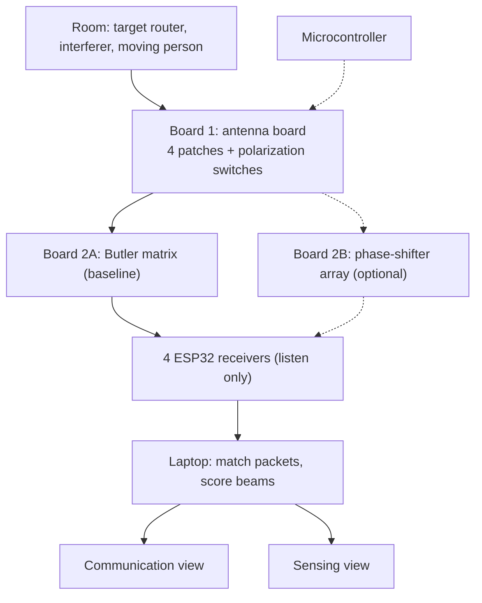

# Project Imara: The Basic Idea

> **Status: research and design.** Nothing has been built or measured yet. Numbers are estimates to be checked in simulation and testing.

*2027 IEEE AP-S Student Design Contest · Reconfigurable Receiving Antennas for Integrated Sensing and Communications (ISAC)*

## 1. The idea in brief

Project Imara is a **listening-only antenna system**. It uses the Wi-Fi signals already in a room to do two jobs:

- **Communication:** lock onto one chosen device and keep a clear link, while ignoring another device that interferes.
- **Sensing:** notice when something (for example, a person) moves, and roughly in which direction.

Our hardware never transmits.

## 2. What the contest asks

- The hardware we design must work **strictly as a receiver**.
- Signals come from **unmodified commercial devices** certified for use in Japan (routers, Bluetooth beacons, phone hotspots).
- Two modes, switching dynamically: **sensing** (using ambient signals to detect movement) and **communication** (aiming at a chosen device while suppressing others with blind spots or polarization).
- Live results that are easy to see, simple enough to rebuild in a classroom, and a total cost **under US$1,500**.

## 3. Building the idea in layers

1. **A room with Wi-Fi.** A router fills the room with invisible radio waves. We never touch it.
2. **One antenna.** A piece of metal that turns passing waves into a tiny electrical signal. It is like one ear: it knows how loud the signal is, but not where it came from.
3. **Four antennas in a row.** A wave reaches each one at a slightly different moment, like four microphones in a row. These timing differences reveal direction.
4. **Four listening directions.** A printed circuit called a Butler matrix turns the four signals into four fixed "listening beams", all heard at the same time.
5. **A busy room.** A second device also sends, and a person walks around. This creates our two jobs.
6. **Job 1: lock on.** Pick the beam that points at our device. If needed, switch the antennas' polarization (explained below).
7. **Job 2: notice movement.** Four receivers, one per beam, record how strong every message is. A moving person makes one beam wobble more than the others.
8. **The laptop.** It collects the readings and shows two live screens, one per job.
9. **Optional upgrade.** A phase-shifter board can aim a blind spot at the interferer.

Read the list from the bottom up to break the idea back down: each layer you remove takes away one ability.



Solid arrows are the baseline design. Dotted arrows are optional.

## 4. How the main parts work

**Antenna board (Board 1).** Four square copper patch antennas, about half a wavelength apart (6.25 cm at 2.4 GHz). Each has two connection points, one for vertical and one for horizontal **polarization** (the direction a wave wiggles). A tiny switch beside each patch picks which one, and one microcontroller flips all four together. Polarization works like a picket fence: a vertical wiggle fits through vertical gaps and is blocked by a sideways fence. It only helps when the wanted and unwanted devices wiggle differently, and reflections in a room reduce the effect (about 13 dB in one indoor study), so we arrange the demo that way and measure it.

**Sorting board (Board 2A, the Butler matrix).** Printed copper with no power: four hybrid couplers, two fixed 45° delay lines and two crossovers. It splits the four antenna signals into beams pointing at about -48.6°, -14.5°, +14.5° and +48.6°. In the ideal case, each beam's peak sits on a blind spot of the other three. Real boards will be less perfect, so we expect to need more than one board version.

**Receivers.** Four ESP32 boards, one per beam, in "sniffer mode": they listen to every Wi-Fi message on a fixed channel without joining a network. For each message they record the sender's ID, the message counter and the signal strength (RSSI). We calibrate the four against each other so their readings agree. ESP32 chips can transmit in hardware, so our firmware must stay listen-only.

**Laptop.** Python code matches the same message across the four receivers (by sender ID and counter), works out the two scores below, and draws the live screens.

## 5. The two modes

**Communication mode ("locking on").**

1. Choose the target by its sender ID. Every other sender is an interferer.
2. For each of the 8 states (4 beams × 2 polarizations), work out the gap between target strength and interferer strength.
3. Pick the state with the biggest gap, hold it, and re-check every few seconds.
4. The screen shows the chosen beam and polarization, and how much the gap improves when the smart selection is on.

**Sensing mode ("watching the invisible").** Radar sends a signal and listens for the echo, but the contest forbids our hardware from transmitting. Instead, the router's constant messages act as the "shout", like a street lamp lighting a room: you notice someone walking by how the light and shadows change. What reaches our antennas is the router's direct signal plus reflections off walls and people. When a person moves, their reflection changes and the strength wobbles.

1. Keep steady traffic on the air (for example, a phone sending small messages 100 to 200 times a second).
2. For every message, subtract the four-beam average from each beam, so changes caused by the router cancel out.
3. Measure how much each beam's leftover varies over the last second or two.
4. The beam that varies most shows where the movement is.

**Limits:** we get a rough direction, not distance or speed, and reflections make neighbouring beams react too. Because all four beams are heard together, the same data can feed both screens at once.

## 6. The math in three lines

```
Direction:     phase difference between neighbouring antennas = 180° × sin(angle)    (spacing = half a wavelength)
Link score:    gap (dB) = target strength − interferer strength    → pick the state with the biggest gap
Motion score:  leftover = beam strength − average of the four beams    → motion = how much the leftover varies
```

## 7. The optional upgrade (Board 2B)

Instead of fixed beams, each antenna's signal goes through an adjustable delay chip (a phase shifter) and an adjustable volume knob (an attenuator). The microcontroller tunes them by trial to aim the beam anywhere and to place a blind spot on the interferer. It listens in one direction at a time and costs more, so we build it only after Board 2A works.

## 8. Rules we follow

- Receive-only hardware, with no transmit-capable radios. We will ask the organisers to confirm that our listen-only ESP32 firmware is acceptable.
- Signal sources are ordinary commercial devices certified for Japan (phone hotspots or certified routers). The interferer is a second router or hotspot, not a jammer.
- Total cost under US$1,500.

## 9. Risks and open decisions

**Risks:** passive sensing is weaker than radar (we test early with a pilot using off-the-shelf antennas); the Butler matrix needs tuning on ordinary board material; messages from off-beam directions may be too weak to catch every time; the four receivers need calibrating; parts can take weeks to arrive.

**Open decisions:**

1. Board 2A as the baseline with Board 2B as the upgrade (our recommendation), or Board 2B alone.
2. Keep the polarization hardware, or rely on blind spots from Board 2B.
3. One receiver or four (start with one or two, grow to four).
