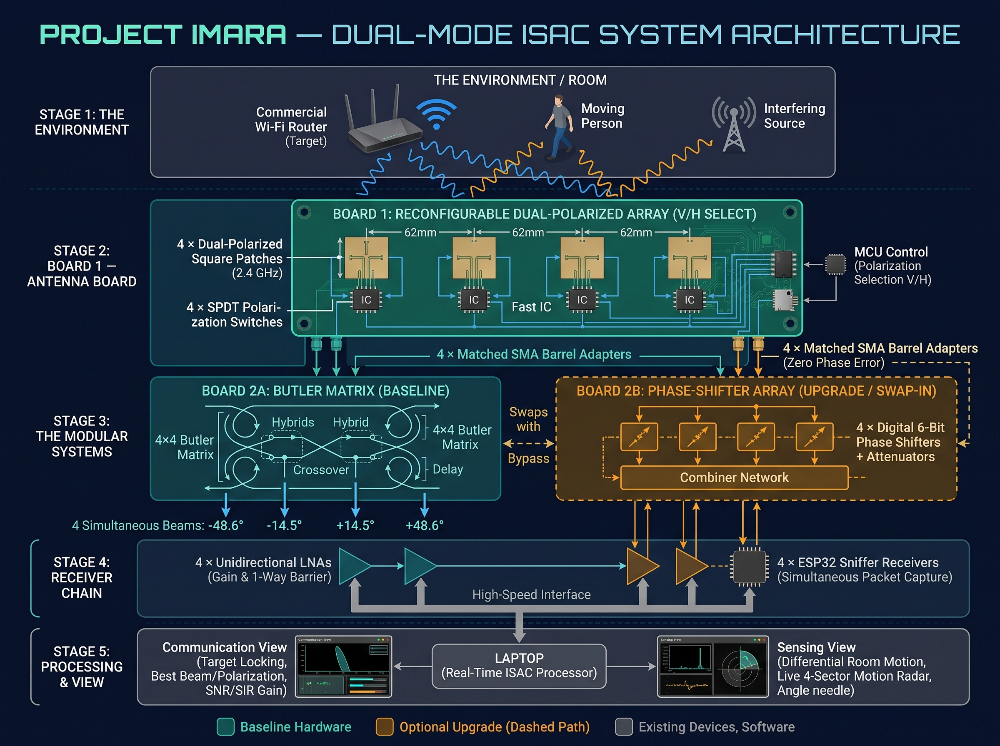

# PROJECT IMARA
## Weekly Technical Work Assignments

* **Project:** Reconfigurable Receiving Antennas for Integrated Sensing and Communication (ISAC)
* **Focus for this week:** Simulate the antenna concept and test whether ordinary Wi-Fi signals can reveal movement.
* **Prepared by:** Rooney Ndereba — Team Lead

---

## 1. Where We Are

We have established the main concept for Project Imara and started working towards its implementation.

The proposed system uses four dual-polarized patch antennas to receive ordinary $2.4\text{ GHz}$ wireless signals. The antenna system is intended to support two functions:

* **Communication:** Improve reception of a selected Wi-Fi signal by choosing a suitable receiving direction and polarization.
* **Sensing:** Observe changes in received wireless signals to identify movement or changes in the surrounding environment.

Our current architecture includes an antenna board, a beam-forming network, a receiver chain and a laptop for processing and displaying measurements.

We have already made progress by calculating the dimensions of a single patch antenna using Michael's Python calculator and simulating it in Fairbeam.

This week's work will build on that progress. We will first concentrate on the four-element antenna array and test the basic Wi-Fi sensing principle.

The Butler matrix will be taken up after our next meeting. This will allow us to concentrate on the antenna design before moving to the next stage.

---

## 2. Team Assignments

### A. Rooney Ndereba — Team Lead, Antenna Design and Simulation
**Main focus:** Four-element dual-polarized patch antenna array

I will take responsibility for developing the single-patch design into a four-element array.

**Tasks:**
* Use the existing single-patch simulation as the starting point.
* Design a four-element patch antenna arrangement operating at approximately $2.4\text{ GHz}$.
* Investigate how each patch can support horizontal and vertical polarization.
* Study the effect of element spacing, starting with the proposed spacing of approximately $62\text{ mm}$.
* Simulate the four-element arrangement and examine its radiation pattern.
* Investigate mutual coupling between adjacent antenna elements.
* Document the design dimensions, simulation settings and results.

**Expected output:**
* [ ] Four-element antenna-array model.
* [ ] Proposed dual-polarized patch arrangement.
* [ ] Radiation-pattern results.
* [ ] Initial assessment of mutual coupling and element spacing.
* [ ] A short summary of design challenges and findings.

> **Note:** This week's work is focused on the antenna array. The Butler matrix design and simulation will begin after the next meeting.

---

### B. Charles Ryan — Hardware Support and Phase-Shifter Research
**Main focus:** Understanding and modelling the optional phase-shifter network

**Tasks:**
* Research the purpose of phase shifters in antenna arrays.
* Explain how changing the phase of signals can change the direction of an antenna array's main beam.
* Develop a basic four-channel phase-shifter model using ideal components.
* Test a few different phase settings and observe their effect on the output phase relationships.
* Where possible, investigate how realistic phase-shifter components introduce losses and phase errors.
* Coordinate with Rooney so that the model uses compatible antenna-array assumptions.
* Support Winnie with hardware research where needed.

**Expected output:**
* [ ] Simple four-channel phase-shifter model.
* [ ] Diagram showing the signal path.
* [ ] Results for different phase settings.
* [ ] Short explanation of how phase adjustment supports beam steering.
* [ ] Initial recommendations on whether this should remain an optional upgrade.

> The priority is to understand and demonstrate the principle. A complete hardware implementation is not required this week.

---

### C. Michael Kimani — Software, Python and Sensing
**Main focus:** Python array calculations and Wi-Fi movement detection

Michael has already developed a Python patch antenna calculator. The existing calculator is a useful starting point and does not need to be completely rewritten this week.

**Tasks:**

**1. Existing patch calculator**
* Review the calculator's input validation and calculation outputs.
* Compare its calculated patch dimensions with the Fairbeam simulation results.
* Record any differences and possible reasons for them.
* Check that the transmission-line and phase-length calculations are treated as preliminary until the final circuit topology is established.

**2. Python array-factor model**
* Develop a basic Python model of a four-element linear antenna array.
* Investigate how element spacing and phase differences affect the array's radiation pattern.
* Generate plots for different phase settings.
* Share the results with Rooney for comparison with the electromagnetic simulation.

**3. Wi-Fi movement-sensing research and experiment**
* Research how ordinary Wi-Fi signals can reveal movement.
* Investigate RSSI (Received Signal Strength Indicator) and CSI (Channel State Information).
* Confirm which measurements are accessible using the proposed ESP32 receiver.
* Develop a basic Python script to collect and store signal measurements.
* Plot received signal measurements against time.
* Compare measurements from a stationary room with measurements taken while a person is moving.

**Expected output:**
* [ ] Python array-factor model and plots.
* [ ] Comparison between calculated and simulated patch dimensions.
* [ ] Research summary on RSSI and CSI.
* [ ] Basic signal-logging and visualization script.
* [ ] Initial movement-sensing observations, if the experiment can be conducted.

---

### D. Winnie Wanja — Hardware Lead, Component Sourcing and System Integration
**Main focus:** Hardware requirements and receiver-chain feasibility

**Tasks:**

**1. Improve the component list**
* Prepare a structured Bill of Materials (BOM) identifying:
  * Component name and required quantity.
  * Function in the Project Imara system.
  * Important technical specifications.
  * Recommended manufacturer and model.
  * Supplier or purchasing link.
  * Estimated unit price and total cost.
  * Alternative components where appropriate.
* Include the antenna PCB and substrate, RF switches, SMA connectors, RF cables, low-noise amplifiers, ESP32 receivers, microcontroller, power supply and other necessary components.
* Separate essential baseline hardware from optional upgrades.

**2. Receiver-chain investigation**
* Study the proposed receiving path and develop a simple model or calculation covering:
  * Signal losses through cables, connectors and switches.
  * Gain provided by the low-noise amplifier.
  * Noise figure and its effect on reception.
  * Whether the selected receiver can work with the expected signal levels.

**3. Receiver synchronization**
* Investigate whether the proposed ESP32 receivers can collect useful measurements at the same time.
* Examine timestamp accuracy and clock differences.
* Identify practical approaches to synchronization.
* Confirm the actual measurement capabilities of the proposed ESP32 model.

**4. Hardware budget**
* Update the project budget using realistic quantities and prices.
* Include fabrication, shipping and other relevant costs where possible.
* Identify components that may be difficult to obtain.
* Recommend suitable alternatives.

**Expected output:**
* [ ] Updated Bill of Materials.
* [ ] Component specifications and supplier information.
* [ ] Updated project budget.
* [ ] Receiver-chain gain and loss calculation.
* [ ] Receiver synchronization research.
* [ ] Recommended hardware connection diagram.

---

### E. Charles and Winnie — Shared Hardware Support
* Charles will support Winnie in checking component specifications, identifying suitable alternatives and understanding how the hardware blocks connect.
* Both should ensure that the proposed components are compatible with the intended $2.4\text{ GHz}$ operating frequency and the receive-only nature of the project.

---

## 3. Shared Experiment: Can Wi-Fi Signals Reveal Movement?

This is a joint project activity, with Michael leading the software and data analysis.

The purpose is to establish whether ordinary Wi-Fi signals can provide useful information about movement in a room.

**Basic experimental arrangement:**
1. Place an ordinary Wi-Fi router in a room.
2. Position an ESP32 receiver so that it can listen to the router.
3. Record signal measurements while the room is stationary.
4. Ask someone to walk across the room.
5. Continue recording measurements during movement.
6. Use Python to plot and compare the results.

**Team contributions:**
* **Michael:** Develop the data-collection and plotting code.
* **Winnie:** Identify and prepare the router, ESP32 and necessary hardware.
* **Charles:** Assist with hardware setup and receiver testing.
* **Rooney:** Relate the observations to the proposed directional antenna system.

> The experiment should be repeated to check whether the results are consistent. A change in RSSI alone is not sufficient proof of reliable movement detection; we must distinguish movement-related changes from normal signal fluctuations.

---

## 4. How Our Work Fits Together

| Team Member | Main Contribution | How It Supports the Project |
| :--- | :--- | :--- |
| **Rooney** | Four-element antenna-array simulation | Establishes the antenna design |
| **Charles** | Phase-shifter modelling | Investigates adjustable beam steering |
| **Michael** | Python calculations and Wi-Fi sensing | Supports modelling and environmental sensing |
| **Winnie** | Components, receiver chain and integration | Establishes hardware feasibility |

Together, these activities will help us determine whether the proposed system is technically achievable and what needs to be improved before building a prototype.

---

## 5. Expected Progress Before the Next Meeting

Each member should be ready to present:
* Their research findings.
* Simulation models, diagrams or calculations.
* Relevant plots and preliminary results.
* Components or software investigated.
* Challenges encountered and questions requiring team discussion.

All research notes, simulation files, Python scripts, diagrams and useful references should be uploaded to the Project Imara GitHub repository. Important updates can also be shared in the WhatsApp group.

Our immediate priority is to establish a sound antenna-array design and obtain initial evidence that ordinary Wi-Fi signals can reveal movement.

We will review the progress together at the next meeting before moving on to the Butler matrix.

---

### **PROJECT IMARA**
*Understand the physics. Design with purpose. Test with evidence. Improve through iteration.*

**Prepared by:**  
Rooney Ndereba  
Team Lead — Project Imara